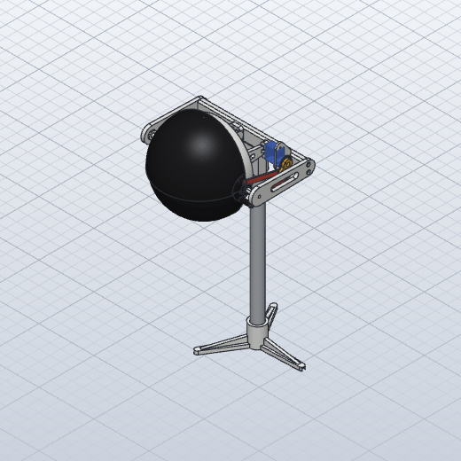

# Ojo animatrónico — diseño y firmware

Ojo animatrónico impreso en 3D con tres servos: giro lateral, inclinación arriba y abajo, y parpadeo. Sigue con la mirada a las personas que tiene delante. Lo ha diseñado [Ibercomp](https://ibercomp.com) para su stand en MATELEC.

- **Artículo con la explicación completa, el montaje paso a paso y la lista de materiales:** [Construye el ojo de MATELEC: visión artificial y código abierto](https://ibercomp.com/ojo-matelec-codigo-abierto/) (blog de Ibercomp).
- **Programa de visión artificial que mueve el ojo:** [ibercomp/ztrak-ojo](https://github.com/ibercomp/ztrak-ojo).

## Inspiración

Inspirado en el ojo animatrónico del vídeo original de Jonny Poole, con un diseño propio de Ibercomp.

## Contenido

| Carpeta | Qué hay |
|---|---|
| `imprimir/` | STL listos para laminar, ya orientados, y perfiles de impresión de referencia (Ender-3 Pro y Anet A8, PLA, 0,2 mm). No se incluye G-code: lamina los STL para tu impresora |
| `docs/` | [Montaje y lista de compra](docs/MONTAJE.md), [impresión](docs/IMPRESION.md), [guía del CAD](docs/GUIA_CAD.md), [planos A3](docs/PLANOS_A3.pdf) e imágenes de las piezas en la cama |
| `cad/` | Piezas en STEP y STL (posición de montaje), proyectos SolidCraft (`.sc`) y sus scripts de modelado |
| `parametros/` | Cotas del diseño; los scripts de `herramientas/` las leen para generar las piezas |
| `herramientas/` | Scripts de generación de piezas, comprobación de interferencias e imprimibilidad, laminado y estabilidad |
| `ViVi_DOIT_3_servos/` | Firmware para el seguimiento con ztrak-ojo: Arduino Nano por USB (`UNO_AVR/`, recomendado) o placa ESP8266 por Wi-Fi (`ESP8266_RTOS/`), y esquemas |
| `firmware/` | Firmware autónomo para ESP32, con punto de acceso Wi-Fi y control desde el móvil |

Por dónde empezar:
1. Imprime la probeta `P99` y comprueba los ajustes ([IMPRESION.md](docs/IMPRESION.md)).
2. Imprime el resto de piezas y compra los componentes de [MONTAJE.md](docs/MONTAJE.md).
3. Monta el ojo siguiendo esa misma guía.
4. Graba el firmware del Nano ([UNO_AVR](ViVi_DOIT_3_servos/UNO_AVR)) y arranca [ztrak-ojo](https://github.com/ibercomp/ztrak-ojo).

Las claves Wi-Fi que aparecen en el firmware son valores de relleno (`cambia-esta-clave`). Cámbialas antes de grabar. En `ESP8266_RTOS`, las credenciales van en `main/wifi_privada.h`, que no se sube a git.

## Licencia

- Diseño (CAD, STEP, STL, planos, imágenes y documentación): [CC BY 4.0](https://creativecommons.org/licenses/by/4.0/). Cita a Ibercomp si lo reutilizas.
- Código (firmware y scripts): [MIT](LICENSE-CODE).

Detalle en [`LICENSE`](LICENSE).
