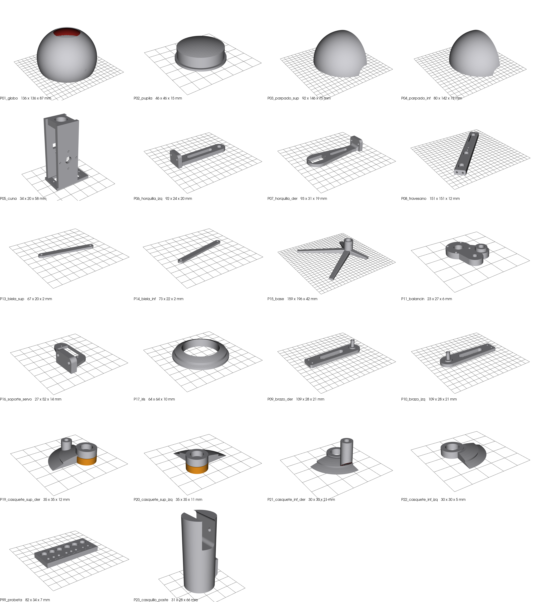

# Impresión — cada pieza tal como va en la cama

Impresora de referencia: Marlin con cama de 200×200 (Ender‑3 Pro / Anet A8), boquilla de 0,4, PLA de 1,75 y capa de 0,2. El diseño está alineado a capas de 0,2: techos, puentes escalonados y alivios caen en múltiplos de 0,2 desde la cama.

Gris: pieza · rojo: cara hacia abajo a más de 45° · naranja: soporte integrado.

## Cómo se comprueba (dos verificadores independientes)

| Herramienta | Qué hace |
|---|---|
| `herramientas/imprimibilidad.py` | Lamina cada pieza ya orientada en capas de 0,2 y compara cada capa con la de debajo. Mide el voladizo (> 45°) y clasifica lo que sobresale > 1 mm como **puente** (busca la dirección de puente como un laminador, ≤ 30 mm) o **ménsula** (si pasa de 2 mm, necesita soporte). Comprueba también las islas, las zonas más finas que una línea, la primera capa, si la pieza cabe en la cama, la estabilidad y los agujeros de ajuste (horizontales u ovalados, y pata de elefante si nacen en la cama) |
| `herramientas/laminar.py` | Lamina con **PrusaSlicer 2.9.6** (CLI, flatpak) usando el perfil `imprimir/perfiles/ender3pro_pla_0.2.ini` y genera el G-code Marlin. El criterio es el **análisis de estabilidad** de PrusaSlicer, el mismo aviso que muestra su interfaz: anclajes de puente en el aire, extrusiones sueltas, puentes largos y poca adherencia |

Flujo: `construir.py` → `mallar.py` → `bandejas.py` (STL orientados a `imprimir/`) → `imprimibilidad.py` → `laminar.py` (G-code a `imprimir/gcode/`, que no se incluye en el repositorio). Las imágenes salen de `render_cama.py docs/cama`.

## Resultado por pieza (PrusaSlicer, perfil Ender‑3 Pro, PLA, capa 0,2)

| Pieza | Orientación | Soportes | Tiempo | g |
|---|---|---|---|---|
| P01 globo | boca trasera en la cama, borde de 4 mm | no | 8 h 12 min | 85,1 |
| P02 pupila | cara trasera plana en la cama | no | 1 h 06 min | 10,4 |
| P03 párpado sup. | de canto sobre el borde delantero (solape), borde de 5 mm | **sí, solo dentro** | 8 h 12 min | 51,5 |
| P04 párpado inf. | de canto sobre el borde delantero (solape), borde de 5 mm | **sí, solo dentro** | 6 h 52 min | 44,0 |
| **P99 probeta (primero)** | plana | no | 1 h 48 min | 13,4 |
| P05 cuna | +Y arriba, borde de 3 mm | no | 1 h 27 min | 10,2 |
| P06 / P07 horquillas | tumbadas | no | 1 h 00 min / 1 h 04 min | 8,6 / 8,8 |
| P08 travesaño | cara delantera en la cama, girado 45° | no | 4 h 43 min | 43,2 |
| P09 / P10 brazos | cara exterior en la cama | no | 1 h 20 min c/u | 11,5 c/u |
| P11 balancín | cara exterior en la cama | no | 16 min | 1,6 |
| P13 / P14 bielas | planas | no | 9 min / 10 min | 1,4 / 1,5 |
| P15 base | patas en la cama | no | 5 h 11 min | 46,6 |
| P16 soporte del servo | tumbado | no | 31 min | 3,8 |
| P17 iris | trasera plana en la cama | no | 57 min | 9,1 |
| P19 / P20 casquetes sup. | cara plana en la cama **+ tapón integrado** | no (el tapón) | 27 min / 23 min | 3,6 / 3,3 |
| P21 casquete inf. der. | cara plana en la cama, borde de 3 mm | no | 24 min | 2,5 |
| P22 casquete inf. izq. | cara plana en la cama | no | 11 min | 1,5 |
| **Total** | | | **≈ 50 h** | **≈ 358 g** |

PrusaSlicer da «Floating bridge anchors» en cuatro piezas, y **los cuatro avisos son esperados**:
- **P19/P20:** no reconoce el tapón suelto como soporte (si lo uniera a la pieza, el aviso desaparecería).
- **P05:** el aviso sale en el puente escalonado del agujero central, a z ≈ 53.
- **P23:** el aviso sale en el techo de la ranura del travesaño, un puente de 12 mm entre las paredes curvas.

`imprimibilidad.py` da puentes de 13,6 mm como mucho, sin ménsulas ni islas. P23 lleva borde de 5 mm, porque mide 66 mm de alto sobre 305 mm² y PrusaSlicer avisaba de «Low bed adhesion».

En automático con umbral de 45°, PrusaSlicer añadiría 5,5 m de soporte dentro de la cúpula del globo (zona a 65°). Su análisis de estabilidad sin soportes la da por buena: es una cúpula de anillos cerrados de 1,6 mm que avanza 0,43 mm por capa.

## Notas para imprimir

- Perfil: `imprimir/perfiles/ender3pro_pla_0.2.ini`. Para la **Anet A8**, cargar además `anet_a8.ini` (va el último). Lleva ajustes contra los hilos:
  - PLA a 200 °C (205 °C en la primera capa).
  - Retracción de 4 mm a 40 mm/s con barrido.
  - Solo retrae al cruzar perímetros y en viajes de más de 2 mm.
  - Los viajes van por dentro de la pieza a 150 mm/s, sin salto en Z.
- Compensación de pata de elefante en el perfil: 0,2 mm.
- **Párpados:** soporte solo desde la cama, con 0,2 mm de distancia de contacto. Quitarlo con cuidado: la cáscara mide 1,2 mm. Al quitar el borde, repasa el canto delantero (es el que solapa) para que no quede rebaba.
- **P19/P20:** al terminar, despegar la pieza; el tapón naranja se queda en la cama.
- **Puentes escalonados (P05, P06):** no necesitan repaso. El agujero queda redondo a partir de la 3.ª capa sobre el techo.
- Regenerar todo: `.venv/bin/python herramientas/bandejas.py && .venv/bin/python herramientas/laminar.py`.
